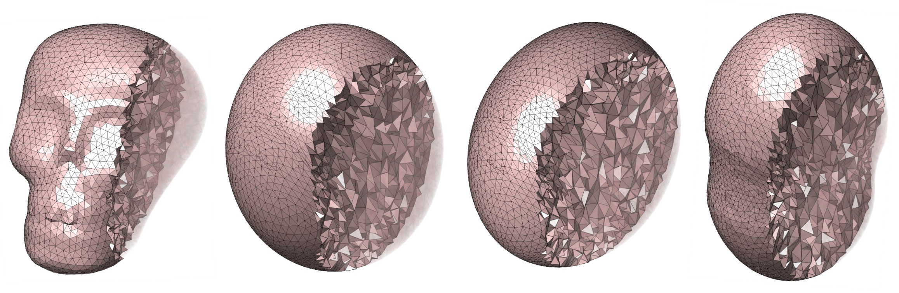

# Adaptive Volumetric Parameterization of Simply Connected 3-Manifolds




`AdaptiveVolumetricMap` computes adaptive volumetric parameterizations of simply connected 3-manifolds, with three methods available (fixed ellipsoidal, adaptive ellipsoidal, and free-boundary volumetric parameterization). All three methods control local shape distortion while equalizing a prescribed mass distribution. They differ in how the target boundary can move.

If you use this software, please cite the following paper:

> Zhiyuan Lyu, Qiguang Chen, Lok Ming Lui, and Gary P. T. Choi.  
> *Adaptive Volumetric Parameterization of Simply Connected 3-Manifolds with Applications.* 
> Preprint, arXiv:2608.08672. 

## Demo

In MATLAB, open the folder containing this code and run

```matlab
demo_AdaptiveVolumetricMap
```

The demo starts with `'fix'` on `Skull.mat`. You can also set `meshFile` to `'Indented_Sphere.mat'` or `'Multi-lobed_Ball.mat'`. The model settings are at the top of the script. The first figure shows the source and mapped boundaries. The second shows the same tetrahedral cutaway in the original and mapped meshes. 

## Main function

```matlab
population = [];
[map, info] = AdaptiveVolumetricMap(v, t, 'Population', population);
```

With `population = []`, all three methods compute the source tetrahedron volumes internally and use them as masses. To supply your own masses, set `population = myMass` in the demo. The vector `myMass` must contain one finite, positive mass per row of `t`. If your data give a source density, each mass is that density times the corresponding source tetrahedron volume.

The following call uses the default free-boundary settings with your population.

```matlab
[map, info] = AdaptiveVolumetricMap(v, t, ...
    'Method', 'free', 'Radii', [0.8 1 1], 'Population', population, ...
    'ShapeWeight', 0.1, 'MaxIterations', 100, ...
    'NumLayers', 3, 'LayerThicknessRatio', 2);
```

To use a tighter stopping tolerance, for example, call

```matlab
[map, info] = AdaptiveVolumetricMap(v, t, ...
    'Population', population, 'MotionTolerance', 1e-4);
```

### Required inputs

- `v` N-by-3 matrix of source vertex coordinates.
- `t` M-by-4 matrix of tetrahedron connectivity. Each row contains four one-based indices into `v`. Every vertex must belong to a tetrahedron.

### Outputs

- `map` N-by-3 matrix of mapped coordinates, in the same vertex order as `v`.
- `info` Structure containing per-tetrahedron measurements, summary statistics, and solver diagnostics.

For the tetrahedron in row `i` of `t`, `info.K(i)` is the ratio of the largest to the smallest singular value of its map Jacobian. Its mapped density `info.density(i)` equals `info.population(i)` divided by its mapped volume. `info.normalized_density` is the density vector divided by its arithmetic mean.

`info.initial_map`, `info.initial_radii`, and `info.final_radii` record the initial map and the target semiaxes. For `'free'`, `info.final_radii` is empty. `info.stop_reason` records why the solver stopped. `info.success` reports solver status, and `info.converged` records whether it reached `info.motion_tolerance`.

### Optional name-value inputs

- `'Method'`
  - `'fix'` keeps the boundary on the prescribed ellipsoid.
  - `'adaptive'` adjusts its semiaxes at constant ellipsoid volume.
  - `'free'` lets the boundary evolve from the initial ellipsoid.

  The function default is `'free'`.
- `'Radii'` Three finite, positive semiaxes [`a` `b` `c`]. These prescribe the target ellipsoid for `'fix'` and the initial ellipsoid for `'adaptive'` and `'free'`. The default `[0.8 1 1]` gives a solid ellipsoid.
- `'Population'` Vector of `M` finite, positive masses in the row order of `t`. When omitted or empty, each mass defaults to the volume of its source tetrahedron.
- `'ShapeWeight'` Nonnegative weight of the shape update relative to a mass weight of `1`. The default is `0.1`. The adaptive model also uses this value to compare candidate ellipsoids.
- `'MaxIterations'` Positive integer limiting the number of main solver steps. The default is `100`.
- `'MotionTolerance'` Positive, finite scalar tolerance for the mean vertex displacement in the main iteration. All three methods use `1e-3` by default.
- `'Interval'` For `'adaptive'`, the number of main steps between attempts to update the ellipsoid semiaxes. Use a positive integer. The default is `5`.

The following two options control the auxiliary mesh for `'free'`.

- `'NumLayers'` Positive integer number of sea layers. The default is `3`.
- `'LayerThicknessRatio'` Positive thickness of each layer in units of the mean boundary edge length after scaling the starting ellipsoid to the unit sphere. The default is `2`.

## Iteration output

The initializer runs silently. Each completed solver step prints three values, also stored in `info.diagnostics.history(:,1:3)` in this order.

- `Step` Main iteration number, starting at `1`.
- `Motion` Mean displacement of the input mesh vertices since the previous step. The solver compares it with `MotionTolerance`.
- `CV(rho_v)` `std(rho_v)/mean(rho_v)`, where `rho_v` contains this step's diffused densities at the input mesh vertices and `std` is MATLAB's sample standard deviation.


The following five summary quantities are also available in `info`.

- `MeanK` `info.mean_K` Mean tetrahedral dilation `K`.
- `SDK` `info.std_K` Sample standard deviation of `K`.
- `var(rho)` `info.density_variance` `var(info.normalized_density, 1)`.
- `Overlaps` `info.overlap_count` Pairs of tetrahedra whose interiors overlap.
- `Iterations` `info.steps` Number of completed main solver steps.

